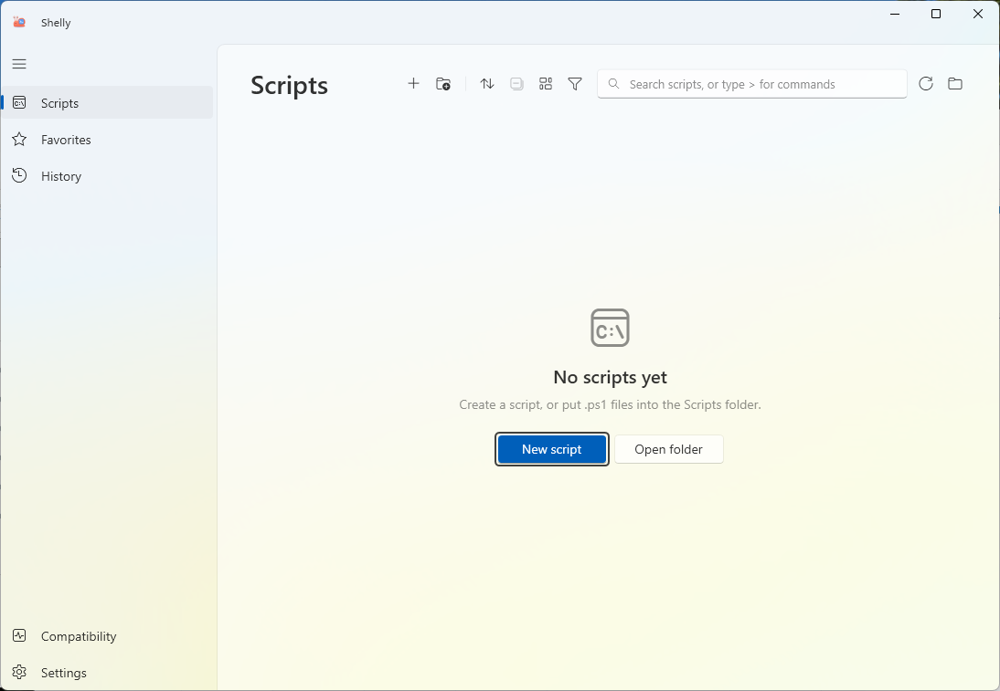

<p align="center"></p>

<h1 align="center">Shelly</h1>

<p align="center">
  <a href="https://github.com/grvelvet/Shelly/releases/latest"></a>
  
  
  
</p>

<p align="center"><b>A portable Windows 11-style launcher for PowerShell, Python and other scripts.</b><br>
Find, run, edit, check and build a .ps1 to .exe in one window. Run .py scripts the same way.</p>
<p align="center"></p>

## Download

[Latest release](https://github.com/grvelvet/Shelly/releases/latest). Unzip anywhere and run `Shelly.exe`. No installer.

| File | Size | Needs |
|---|---|---|
| `shelly-<version>.zip` | about 2 MB | [.NET 10 Desktop Runtime](https://dotnet.microsoft.com/download/dotnet/10.0) (x64) |
| `shelly-<version>-selfcontained.zip` | about 70 MB | nothing |

Use the small build. If the runtime is missing, Windows shows a download link, or install it with `winget install Microsoft.DotNet.DesktopRuntime.10`.

**Check the file.** Each release has `SHA256SUMS.txt`.

```powershell
Get-FileHash .\shelly-1.4.1.zip -Algorithm SHA256
```

`Shelly.exe` is not code-signed. SmartScreen may warn. After the checksum matches: **More info → Run anyway**. If the browser marked the zip, unblock it first: `Unblock-File .\shelly-1.x.x.zip`.

## What it does

- Searchable list of every `.ps1`, `.py`, `.bat` and `.cmd` in `Scripts`, with folders, favorites and filters.
- Extra script folders from anywhere on disk (Settings → Folders and files): the scripts run in place.
- Windows PowerShell 5.1 or PowerShell 7. Auto picks the engine, or you pin it.
- Python 3 scripts (`.py`) next to PowerShell ones, marked **PY** in the list (see [Python scripts](#python-scripts)).
- Batch files (`.bat`, `.cmd`) built in, and custom interpreters for any other extension (`.js` → node…), see
  [Batch files and custom interpreters](#batch-files-and-custom-interpreters).
- Reads `param()` and shows a dialog.
- Safety check on PowerShell's AST. A guardrail, not a sandbox.
- Blocks scripts marked as downloaded until you unblock them.
- Output, history, tray, hotkey (Ctrl+Alt+L), jump list.
- Runs in a separate window by default (or inline output, in Settings) while still capturing the full console output to
  History and the output panel; notifications with the result and the exit code, a click opens the run in History.
- Schedules through Windows Task Scheduler (once, daily, days of the week, at sign-in, every N minutes), also when
  Shelly is closed; per user, no administrator rights.
- Parameter presets: named sets of values per script, from the menu, the favorites or a schedule (stored as plain
  text in the settings file, not for passwords).
- Built-in editor with syntax highlighting (light and dark themes for PowerShell, Python, Batch, and custom scripts),
  code completion, live linter with wavy underlines and a Problems panel (`F8`), F5 to save and run, or one-click
  choice of external editor (VS Code, Notepad++, PowerShell ISE, Notepad, or custom).
- Build a script to a small `.exe`.
- English and Russian.

Details: [English guide](docs/USER_GUIDE.md) · [Русский](docs/USER_GUIDE_RU.md) · [Changelog](CHANGELOG.md) · [Возможности (кратко, RU)](docs/FEATURES_RU.md)

## Python scripts

Since 1.1.0 Shelly lists and runs `.py` files too, in `Scripts` and in the added folders. A Python script row carries the
**PY** mark and a code icon.

- **Interpreter.** Settings → Environment, pick *Python* in the *Runtime* list. One line shows what is used, for example
  `Python 3.12 · auto-detect` or `Python 3.13 · custom path` (the full path is in its tooltip). *Choose…* sets your own
  `python.exe`, *Reset* goes back to auto-detect: the `py` launcher (`py -3`), then `python.exe` on PATH (the Microsoft
  Store placeholder in `WindowsApps` is skipped unless it really starts Python), then
  `%LOCALAPPDATA%\Programs\Python\Python3*` and `Program Files\Python3*`.
- **Virtual environments (1.1.1).** A `.venv`, `venv` or `env` folder (with `pyvenv.cfg`) in the script's folder or a
  parent, up to the root of `Scripts` or of the added folder, is used first; the nearest one wins. The run gets
  `VIRTUAL_ENV`, the venv's `Scripts` folder first on PATH and no `PYTHONHOME`, like `activate`. The row shows a
  **venv** mark and the output header says `.venv · Python 3.12`. A venv without `python.exe` is an error: Shelly does
  not fall back to another Python. Turn it off with *Use .venv next to the script*. Order: venv, then your path, then
  auto-detect.
- **Run.** `python -u script.py` in the script's folder, with `PYTHONUTF8=1` and `PYTHONIOENCODING=utf-8`, so output
  arrives line by line and Cyrillic text is not broken. Output, history, exit code, Stop (the whole process tree),
  separate window and administrator runs work as for PowerShell. The SHA-256 of the file is checked right before the start
  (after the UAC prompt too).
- **Arguments.** Run settings (the gear button) has one *Arguments* box; its text goes to `sys.argv`, split like a command
  line (`--name "Anna Smith" -v`). There is no `param()` dialog for Python.
- **No Python?** The run stops with a message that links to Settings and to python.org. Nothing crashes.
- **What is different.** The safety check reads PowerShell only, so Python scripts are not checked for dangerous commands
  (Mark of the Web still blocks downloaded files). *Build .exe* is for PowerShell scripts only. Files starting with `_`
  (such as `__init__.py`), `__pycache__`, `site-packages`, `node_modules` and virtual environments (a folder with
  `pyvenv.cfg`) are not listed.
- **New script.** Type a name ending in `.py` in *New script* to create a Python one. Drag and drop and *Add scripts…*
  (the `>` commands, or the menu of the Scripts group) take `.ps1`, `.py`, `.bat`, `.cmd` and custom interpreter files.

## Batch files and custom interpreters

Since 1.3.0 `.bat` and `.cmd` files are listed and run with `cmd.exe` (nothing to set up; mark **BAT**/**CMD**). One
*Arguments* box, presets, schedules, history and favorites work as for Python. Non-English output works inline: UTF-8
files get `chcp 65001`, and each output line is read as UTF-8 or else in the OEM code page. In the output panel `pause`
returns at once (no keyboard input there); run such files in a window. Batch files get a basic check of known dangerous
commands (`del /s`, `rd /s`, `format`, `reg delete`…).

*Custom interpreters* (Settings → Environment) give any other extension to a program you choose, with an arguments
template (`{script} {args}`, `{dir}`). Shelly does not look for these programs and does not check these scripts for
dangerous commands.

## Scripts with their own files (Import folder)

*Import folder…* (the `>` commands, the menu of the Scripts group) or a folder dropped on the Scripts page copies the
whole folder into `Scripts`, so a script keeps its configs, data and modules next to it. A small dialog asks for the
folder name (the source name by default; a name already in `Scripts` is refused) and lists the script files
found, all ticked: unticked ones are copied but not shown. It also shows how many files and how much will be copied.

- Not copied: Python environments (`.venv`, `venv`, `env` with `pyvenv.cfg`), `__pycache__`, `.git`, `node_modules`.
  Links and junctions are not followed. Create the venv again in the copy (`python -m venv .venv`).
- The copy goes to a hidden temporary folder and is renamed into place at the end: a failure leaves nothing half done.
- Over 100 MB or 2000 files Shelly suggests *Add as external folder* (the scripts run where they are) or *Import anyway*.
- These scripts carry a small folder mark (*Script with its own files*) and run in their own folder. Deleting one asks
  first and shows that the whole folder goes to the Recycle Bin (name, files, size); with several scripts in it you can
  instead remove only that script from the list. The folder holds a small `.shelly.json` with the hidden scripts.
- Find your files from the script's own location, not the current folder: `Path(__file__).parent / "config.json"`
  in Python, `Join-Path $PSScriptRoot 'config.json'` in PowerShell.
- The SHA-256 check before a run covers the script file only, not the other files of the folder.

## Folder layout

```
Shelly\
  Shelly.exe
  Scripts\
  build\
  launcher-settings.json
  launcher-history\
```

Folders you add in Settings stay where they are; Shelly never copies or moves their scripts.

## Build from source

Needs the [.NET 10 SDK](https://dotnet.microsoft.com/download/dotnet/10.0) (`global.json` picks the newest 10.0.x)
and Windows PowerShell 5.1 or PowerShell 7.

```powershell
.\build.ps1                # build, test, publish, pack: everything CI runs
.\build.ps1 test           # tests only; results in artifacts\test-results\*.trx
.\build.ps1 local          # Shelly.exe in the repository root, next to Scripts, to try it out
.\build.ps1 publish -Flavor fd
.\build.ps1 clean
```

Everything goes to `artifacts\`: `publish\fd` and `publish\sc` (single-file `Shelly.exe`), `dist\` (the release
zips and `SHA256SUMS.txt`), `test-results\`. `build.bat` still works and calls `build.ps1`. The version is
`VersionPrefix` in `Directory.Build.props`; a local build is `1.4.1-dev`.

Release: set `VersionPrefix` and a `CHANGELOG.md` section, merge to `main`, push the tag `v<version>`. The Release
workflow tests and packs the tag and publishes both zips with the CHANGELOG section as the notes. Details (Russian):
[docs/BUILD_RU.md](docs/BUILD_RU.md).

## Security

Scripts run with your rights. Shelly is not a sandbox. See [SECURITY.md](SECURITY.md).

## Support

If Shelly saves you time, you can [support the project on Boosty](https://boosty.to/koms) ☕ (Поддержать проект).

## License

[MIT](LICENSE). The editor is [AvalonEdit](https://github.com/icsharpcode/AvalonEdit) (MIT).
