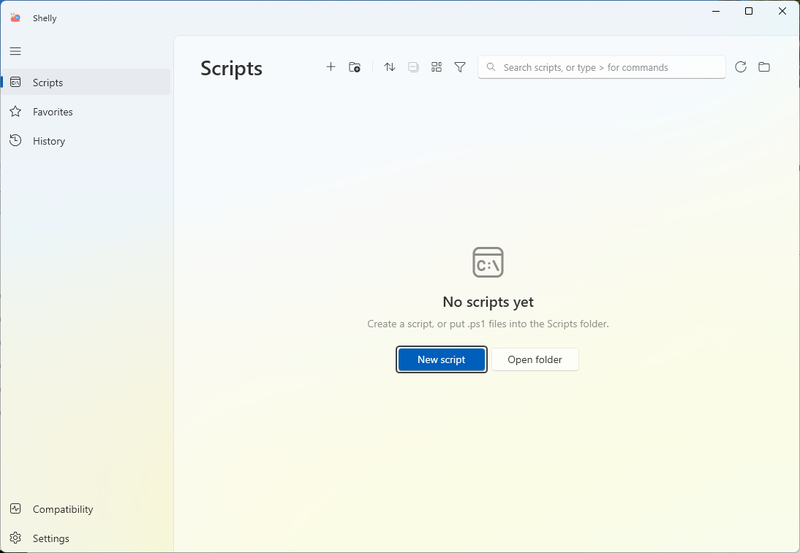

<p align="center"></p>

<h1 align="center">Shelly</h1>

<p align="center">
  <a href="https://github.com/grvelvet/Shelly/releases/latest"></a>
  
  
  
</p>

<p align="center"><b>A portable Windows 11-style launcher for PowerShell, Python, Batch and custom scripts.</b><br>
Find, run, edit, check and build `.ps1` to `.exe` in one window.</p>
<p align="center"></p>

## Download

[Latest release](https://github.com/grvelvet/Shelly/releases/latest). Unzip anywhere and run `Shelly.exe`. No installer.

| File | Size | Needs |
|---|---|---|
| `shelly-<version>.zip` | about 2 MB | [.NET 10 Desktop Runtime](https://dotnet.microsoft.com/download/dotnet/10.0) (x64) |
| `shelly-<version>-selfcontained.zip` | about 70 MB | nothing |

Use the small build. If the runtime is missing, Windows shows a download link, or install it with `winget install Microsoft.DotNet.DesktopRuntime.10`.

Verify the archive against `SHA256SUMS.txt` (`Get-FileHash .\shelly-1.5.0.zip -Algorithm SHA256`). Because `Shelly.exe` is not code-signed, SmartScreen may warn: **More info → Run anyway** (unblock downloaded zips first with `Unblock-File`).

## What it does

- **Script library & folders:** lists `.ps1`, `.py`, `.bat`, `.cmd`, and custom interpreter extensions from `Scripts`, external folders (run in place), or imported folders (scripts with their own configs/data); folders, favorites, sort, views, and filters.
- **Engines & runtimes:** auto-picks Windows PowerShell 5.1 or PowerShell 7 (`#Requires` and syntax-aware), detects Python 3 and nearest `.venv`, runs Batch via `cmd.exe` (UTF-8 / OEM), and supports custom interpreters (`{script} {args} {dir}`).
- **Parameters & presets:** builds a dialog from PowerShell `param()`, offers an *Arguments* box for other scripts, and saves named presets.
- **Execution & output:** runs in a separate window (default), inline, GUI, hidden, or as administrator while capturing live console output to the output panel and History; desktop notifications on finish.
- **Safety guardrail:** PowerShell AST analysis and basic Batch scanning with color-coded shields (red/amber/green), trusted HTTPS sources, and Mark of the Web blocking. Not a sandbox.
- **Schedules:** Windows Task Scheduler integration (once, daily, weekly, at sign-in, every N minutes) with headless execution when Shelly is closed.
- **Built-in editor & linter:** AvalonEdit with light/dark syntax highlighting, code completion (`Ctrl+Space`), live diagnostics with wavy underlines and a Problems panel (`F8`), `F5` save & run, or one-click external editor (VS Code, Notepad++, ISE, custom).
- **Build `.exe` & system integration:** compiles `.ps1` scripts to standalone console `.exe`, tray menu, global hotkey (`Ctrl+Alt+L`), taskbar jump list, English and Russian UI.

Details: [User Guide (EN)](docs/USER_GUIDE.md) · [Руководство (RU)](docs/USER_GUIDE_RU.md) · [Changelog](CHANGELOG.md) · [Security](SECURITY.md)

## Language support

| Capability | PowerShell | Python | Batch | Custom |
|---|:-:|:-:|:-:|:-:|
| Parameter form (`param()`) | yes | no | no | no |
| Arguments box & presets | presets | yes | yes | yes |
| Startup safety check | full (AST) | no | basic | no |
| Live editor linter (`F8`) | yes (AST + rules) | yes (`ast.parse` + rules) | yes (rules + scanner) | basic |
| Syntax highlighting & completion (`Ctrl+Space`) | yes | yes | yes | highlighting only |
| Auto-detect / `.venv` | PS 5.1 / 7 | Python + `.venv` | `cmd.exe` | no |
| Window output capture, History, Schedules, MOTW | yes | yes | yes | yes |
| Build `.exe` | yes | no | no | no |

## Folder layout

```
Shelly\
  Shelly.exe
  Scripts\
  build\
  launcher-settings.json
  launcher-history\
```

External folders added via Settings or drag-and-drop stay where they are; Shelly never copies or moves their scripts.

## Build from source

Requires the [.NET 10 SDK](https://dotnet.microsoft.com/download/dotnet/10.0) and Windows PowerShell 5.1 or PowerShell 7:

```powershell
.\build.ps1                # build, test, publish, pack (matches CI)
.\build.ps1 test           # run tests (results in artifacts\test-results\*.trx)
.\build.ps1 local          # copy Shelly.exe to repo root next to Scripts
.\build.ps1 clean          # remove build artifacts
```

Outputs are written to `artifacts\`. See [docs/BUILD_RU.md](docs/BUILD_RU.md) for the full developer and release guide.

## Security

Scripts run with your user rights. Shelly is a static guardrail, not a sandbox. See [SECURITY.md](SECURITY.md).

## Support

If Shelly saves you time, you can [support the project on Boosty](https://boosty.to/koms) ☕.

## License

[MIT](LICENSE). The editor uses [AvalonEdit](https://github.com/icsharpcode/AvalonEdit) (MIT).
